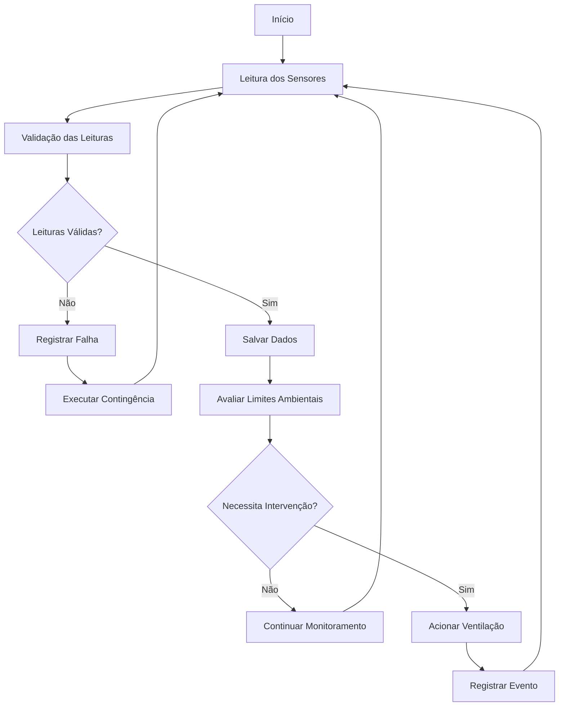

# SISTEMA DE AUTOMAÇÃO INTEGRADA PARA CONTROLE AVIÁRIO: OTIMIZAÇÃO DO ÍNDICE DE TEMPERATURA E UMIDADE GLOBAL (ITGU) E DA QUALIDADE GASOSA PARA EFICIÊNCIA PRODUTIVA NA AVICULTURA DE PRECISÃO

## Autores

**ANDREIA SOUZA S. DA SILVA**¹  
**CRISTIANO CRUZ**²  
**ELIENAI CARDOSO**³  
**KENNEDY CRUZ**⁴

¹ Universidade Federal de Mato Grosso (UFMT)  
² Universidade Federal de Mato Grosso (UFMT)  
³ Universidade Federal de Mato Grosso (UFMT)  
⁴ Universidade Federal de Mato Grosso (UFMT)

**Programa de Pós-Graduação**

---

# RESUMO

A avicultura de precisão tem incorporado tecnologias digitais com o objetivo de otimizar os processos produtivos, garantir o bem-estar animal e melhorar a eficiência operacional dos sistemas de produção. Neste contexto, o presente trabalho apresenta o desenvolvimento de um sistema de automação integrada para monitoramento e controle ambiental em aviários, fundamentado em conceitos de Internet das Coisas (IoT), automação rural e análise de dados.

A solução desenvolvida permite a aquisição contínua de temperatura, umidade relativa do ar e concentração de amônia, promovendo a avaliação das condições ambientais por meio do Índice de Temperatura e Umidade Global (ITGU). O sistema integra sensores, banco de dados, mecanismos automáticos de ventilação e ferramentas de visualização, possibilitando a tomada de decisão baseada em dados.

Os resultados demonstram o potencial da automação aplicada à avicultura de precisão para redução do estresse térmico, melhoria das condições de ambiência e apoio ao gerenciamento produtivo.

**Palavras-chave:** Avicultura de Precisão; Automação Rural; Internet das Coisas; ITGU; Monitoramento Ambiental; Qualidade Gasosa.

---

# 1. INTRODUÇÃO

A produção avícola moderna depende diretamente do controle das condições ambientais para garantir elevados índices de desempenho produtivo e zootécnico. Temperatura, umidade relativa do ar e concentração de gases são variáveis que influenciam diretamente o conforto térmico, a saúde e a produtividade das aves.

O uso de tecnologias de automação associadas à Internet das Coisas (IoT) permite o monitoramento contínuo dessas variáveis, fornecendo informações em tempo real e possibilitando respostas automáticas às alterações ambientais. Dessa forma, a automação integrada representa uma alternativa para aumentar a eficiência dos sistemas de produção e contribuir para a sustentabilidade da atividade avícola.

---

# 2. OBJETIVOS

## 2.1 Objetivo Geral

Desenvolver um sistema de automação integrada para monitoramento e controle ambiental aplicado à produção avícola.

## 2.2 Objetivos Específicos

- Monitorar temperatura, umidade relativa do ar e concentração de amônia;
- Calcular indicadores ambientais, incluindo o ITGU;
- Armazenar dados históricos em banco de dados;
- Automatizar o acionamento dos sistemas de ventilação;
- Disponibilizar gráficos e relatórios técnicos;
- Apoiar a tomada de decisão baseada em dados;
- Avaliar indicadores ambientais e produtivos.

---

# 3. MATERIAL E MÉTODOS

## 3.1 Caracterização da Unidade Experimental

| Parâmetro | Valor |
|------------|---------|
| Comprimento | 30 m |
| Largura | 12 m |
| Área Total | 360 m² |
| Capacidade Instalada | Aproximadamente 4.000 aves |
| Densidade de Alojamento | 10 a 11 aves/m² |
| Ciclo Produtivo | 65 a 75 dias |
| Pé-direito | ≥ 2,80 m |

## 3.2 Delineamento Experimental

### Grupo Experimental (GE)

Aviário equipado com sistema de automação integrada para monitoramento e controle ambiental.

### Grupo Controle (GC)

Aviário submetido ao manejo convencional, sem utilização da automação desenvolvida.

## 3.3 Variáveis Monitoradas

- Temperatura do ar (°C);
- Umidade relativa do ar (%);
- Concentração de amônia (ppm);
- Estado dos atuadores;
- Índice de Temperatura e Umidade Global (ITGU).

---

# 4. ARQUITETURA DO SISTEMA

A arquitetura do sistema foi estruturada nos seguintes módulos:

1. Sensoriamento Ambiental;
2. Aquisição de Dados;
3. Processamento das Informações;
4. Banco de Dados;
5. Controle Automático;
6. Exportação de Dados;
7. Visualização de Informações;
8. Geração de Relatórios;
9. Apoio à Tomada de Decisão.

---

# 5. FLUXO OPERACIONAL



---

# 6. IMPLEMENTAÇÃO COMPUTACIONAL

## Execução da Aplicação

```bash
python -m src.main
```

## Exportação de Dados

```bash
python -m src.exportar_csv
```

## Geração de Gráficos

```bash
python -m src.gerar_graficos
```

## Execução dos Testes

```bash
pytest
```

---

# 8. RESULTADOS

## Figura 1 – Aviário Experimental

```text
imagens/aviario_experimental.jpg
```

## Figura 2 – Sensores Utilizados

```text
imagens/sensores.jpg
```

## Figura 3 – Arquitetura do Sistema

```text
imagens/arquitetura_sistema.png
```

## Figura 4 – Interface de Monitoramento

```text
imagens/dashboard.png
```

## Gráfico 1 – Evolução da Temperatura

```text
graficos/temperatura.png
```

## Gráfico 2 – Evolução da Umidade Relativa

```text
graficos/umidade.png
```

## Gráfico 3 – Evolução do ITGU

```text
graficos/itgu.png
```

## Gráfico 4 – Concentração de Amônia

```text
graficos/amonia.png
```

---

# 9. MATERIAL SUPLEMENTAR

## Artigo Científico

Arquivo PDF contendo o manuscrito completo da pesquisa:

```text
docs/Automacao_Hibrida_em_Aviarios_Otimizacao_do_ITGU_e_Qualidade_Gasosa.pdf
```

## Slides da Apresentação

Material utilizado para apresentação e defesa do projeto:

```text
docs/apresentacao_projeto.pdf
```

ou

```text
docs/apresentacao_projeto.pptx
```

## Relatório Final

```text
docs/relatorio_final.pdf
```

---

# 10. VÍDEO DEMONSTRATIVO

## Opção 1 – Link Externo

```text
https://www.youtube.com/watch?v=SEU_VIDEO
```

## Opção 2 – Arquivo Local

```text
videos/demonstracao_sistema.mp4
```

---

# 11. DISCUSSÃO

A utilização de sistemas automatizados para monitoramento ambiental permite maior precisão no controle das condições internas dos aviários, reduzindo a dependência de intervenções manuais e possibilitando respostas rápidas às alterações ambientais.

A integração entre sensores, armazenamento de dados e mecanismos automáticos de controle contribui para a melhoria da ambiência e fornece informações relevantes para o gerenciamento da produção avícola.

---

# 12. CONCLUSÃO

O sistema desenvolvido demonstrou potencial para monitoramento contínuo das condições ambientais em aviários, fornecendo informações em tempo real e possibilitando o acionamento automático de dispositivos de ventilação.

A arquitetura proposta representa uma alternativa viável para aplicações em avicultura de precisão, podendo ser expandida futuramente com técnicas de inteligência artificial, aprendizado de máquina e integração com plataformas avançadas de gestão agropecuária.

---

# REFERÊNCIAS

ABPA. Associação Brasileira de Proteína Animal. Relatório Anual da Avicultura Brasileira.

NÄÄS, I. A. Avicultura de Precisão: Aplicações e Perspectivas.

SILVA, I. J. O. Ambiência na Produção Animal.

TINÔCO, I. F. F. Ambiência e Instalações para Avicultura Industrial.

---

# AGRADECIMENTOS

Os autores agradecem à Universidade Federal de Mato Grosso (UFMT), aos docentes do Programa de Pós-Graduação, aos orientadores, colaboradores e instituições que contribuíram para o desenvolvimento desta pesquisa.

---

# LICENÇA

Projeto desenvolvido exclusivamente para fins acadêmicos, científicos e educacionais.

© ANDREIA SOUZA S. DA SILVA  
© CRISTIANO CRUZ  
© ELIENAI CARDOSO  
© KENNEDY CRUZ
